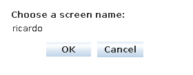
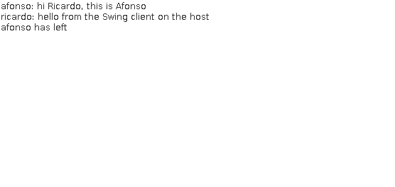

# CA4 - Containerization with Docker

Technical report for the fourth class assignment (CA4) of Configuracao e
Gestao de Sistemas (COGSI), Mestrado em Engenharia Informatica, Instituto
Superior de Engenharia do Porto.

- Topic: containers with Docker.
- Group repository: `Af-Oliveira/COGSI-2026-2027`.
- Milestone tags: `ca4-part1` and `ca4-part2`.
- Applications: the chat server of CA1 Part 1 (`CA1/part1`) and the Gradle
  version of the Bookstore Spring Boot application (`CA1/part2`).

This report follows a tutorial style: each requirement of the assignment is
quoted before the steps that implement it, the commands, the output they
produced and the explanation. Executing the instructions in order reproduces
the assignment. Every command is run from the root of the repository unless
stated otherwise.

---

## Table of contents

1. [Overview](#1-overview)
2. [Environment and prerequisites](#2-environment-and-prerequisites)
3. [Repository layout](#3-repository-layout)
4. [Part 1 - One image per CA1 application](#4-part-1---one-image-per-ca1-application)
5. [Part 2 - proxy, web and db with Docker Compose](#5-part-2---proxy-web-and-db-with-docker-compose)
6. [Alternative solution - analysis and design](#6-alternative-solution---analysis-and-design)
7. [Alternative solution - implementation](#7-alternative-solution---implementation)
8. [Operative guidelines and team work](#8-operative-guidelines-and-team-work)
9. [References](#9-references)

---

## 1. Overview

CA1 produced two Java applications built with Gradle, CA2 ran them in
virtual machines created by Vagrant and CA3 configured those machines with
Ansible. CA4 packages the same applications in containers:

- **Part 1** builds one image for the chat server and one for the Bookstore,
  each in three ways (source cloned and built inside the image, JAR built on
  the host, multi-stage build), and compares the results.
- **Part 2** rebuilds the three-tier environment of CA2 Part 2 (`proxy`,
  `web`, `db`) with Docker Compose.
- The **alternative** implements the same goals with Podman.

---

## 2. Environment and prerequisites

| Component | Version | Notes |
| --- | --- | --- |
| Host | Debian GNU/Linux 13 (trixie), kernel 6.12, x86-64 | 12 CPUs, 16 GB RAM |
| Docker Engine | 29.9.2 (API 1.56) | containerd 2.4.2 image store |
| Docker Buildx | 0.38.1 | BuildKit: cache mounts, Dockerfile-specific ignore files |
| Docker Compose | 5.6.1 | Part 2 |
| JDK on the host | OpenJDK 21.0.4 | only for version 2 of each image and for the chat client |
| Base images | `eclipse-temurin:21.0.13_9-jdk`, `eclipse-temurin:21.0.13_9-jre-alpine` | pinned to a JDK release, see [section 4.1](#41-build-strategies-and-base-images) |

> The images use the containerd image store, the default of Docker Engine 29.
> `docker image ls` shows two sizes: **disk usage** (the unpacked layers) and
> **content size** (the compressed layers, which is what is downloaded from a
> registry).

---

## 3. Repository layout

```text
CA4/
├── README.md                 this report
├── assets/                   screenshots used in the report
└── part1/
    ├── chat/                 chat server images (section 4.2)
    │   ├── v1/               Dockerfile + Dockerfile.dockerignore
    │   ├── v2/
    │   └── v3/
    ├── bookstore/            Bookstore images (section 4.3)
    │   ├── v1/
    │   ├── v2/
    │   └── v3/
    └── measure.sh            builds, inspects and scans the six images (section 4.4)
```

The applications are not copied into `CA4/`: versions 2 and 3 use `CA1/part1`
and `CA1/part2` as their build context, and version 1 clones them from the
group repository.

---

## 4. Part 1 - One image per CA1 application

> The goal of the Part 1 of this assignment is to gain hands-on experience
> with Docker by creating separate images and containers for each CA1
> application [...] You should create a Docker image (i.e., by using a
> Dockerfile) to execute the server. You should be able to run the server in a
> container and connect to it using the client running on your host computer

### 4.1. Build strategies and base images

> Create three versions of your solution: Version 1 - Build the application
> entirely inside the Docker image using source code cloned during image
> creation. Version 2 - Build the server on the host machine and copy the
> resulting JAR file into the Docker image. Version 3 - Implement a
> multi-stage build to separate the build and runtime stages

Each application has one directory per version, with a `Dockerfile` and its
ignore file:

| Version | Where the JAR is built | Build context | Base image of the final image |
| --- | --- | --- | --- |
| `v1` | inside the image, from a `git clone` | the empty `v1/` directory | `eclipse-temurin:21.0.13_9-jdk` (Ubuntu) |
| `v2` | on the host, with the Gradle Wrapper | the CA1 project | `eclipse-temurin:21.0.13_9-jre-alpine` |
| `v3` | in a build stage of the same Dockerfile | the CA1 project | `eclipse-temurin:21.0.13_9-jre-alpine` |

Choices common to every image:

- **Eclipse Temurin.** The official OpenJDK build of the Adoptium project,
  available as JDK and JRE, on Ubuntu and on Alpine. Version 1 needs the JDK
  (it compiles); versions 2 and 3 only run a JAR and use the JRE.
- **Pinned tags.** `21.0.13_9` instead of `21`: a rebuild next month uses the
  same Java release, so the comparison is not affected by an upstream update.
- **Same runtime image in `v2` and `v3`.** Both final images start from the
  same JRE, so the comparison shows what each strategy adds on top of it.
- **Same Gradle task in every version.** The chat server uses `packageApp`,
  a task written in CA1 that produces the thin JAR and copies its runtime
  dependencies to `build/libs/lib`. The tests are not run in the images,
  so the three build times measure the same work.
- **Exec form for `ENTRYPOINT`.** `java` runs as PID 1, without a shell in
  between, and receives the `SIGTERM` sent by `docker stop`. The port is the
  `CMD`, so it can be replaced at `docker run` time.
- **Dockerfile-specific ignore files.** The three versions of an application
  share the same build context (the CA1 project) but need different files
  from it. BuildKit reads `<Dockerfile name>.dockerignore` next to the
  Dockerfile before the `.dockerignore` of the context, so each version has
  its own `Dockerfile.dockerignore` and nothing is added to the CA1 folders.

### 4.2. Chat server

The chat server (`org.example.ChatServerApp`) listens on the port given as its
only argument, `59001` in every image. The client is a Swing application that
runs on the host.

#### Version 1 - clone and build inside the image

[`part1/chat/v1/Dockerfile`](part1/chat/v1/Dockerfile):

```dockerfile
FROM eclipse-temurin:21.0.13_9-jdk

ARG REPO_URL=https://github.com/Af-Oliveira/COGSI-2026-2027.git
ARG REPO_REF=main

RUN apt-get update \
 && apt-get install -y --no-install-recommends git \
 && rm -rf /var/lib/apt/lists/*

RUN git clone --depth 1 --branch "${REPO_REF}" "${REPO_URL}" /src

WORKDIR /src/CA1/part1
RUN ./gradlew --no-daemon --console=plain :app:packageApp

RUN mkdir -p /opt/chat \
 && cp app/build/libs/chat-server-*.jar /opt/chat/chat-server.jar \
 && cp -r app/build/libs/lib /opt/chat/lib

EXPOSE 59001
ENTRYPOINT ["java", "-cp", "/opt/chat/chat-server.jar:/opt/chat/lib/*", "org.example.ChatServerApp"]
CMD ["59001"]
```

- `git` is installed in the image only to clone, and `--no-install-recommends`
  plus the removal of the package lists keep that layer small.
- `--depth 1 --branch "${REPO_REF}"` downloads a single revision. `REPO_REF`
  accepts a branch or a tag, so the image can be rebuilt from a fixed
  revision (`--build-arg REPO_REF=ca4-part1`).
- The repository is public, so no credentials are needed. A private
  repository would need a BuildKit secret (`RUN --mount=type=secret`), never
  a token in a `--build-arg`, which is recorded in the image history.
- Docker caches the `git clone` layer by its instruction text, not by the
  content of the repository. A new commit is only picked up with
  `--no-cache` or a different `REPO_REF`.

```bash
docker build -t cogsi-chat:v1 CA4/part1/chat/v1
```

The context is the `v1/` directory itself, and its ignore file excludes
everything (`*`): the builder receives 0 bytes from the host.

#### Version 2 - JAR built on the host

```bash
(cd CA1/part1 && ./gradlew :app:packageApp)
docker build -f CA4/part1/chat/v2/Dockerfile -t cogsi-chat:v2 CA1/part1
```

```console
Generated application JAR: chat-server-1.0.jar
app/build/libs:
chat-server-1.0.jar
lib

app/build/libs/lib:
log4j-api-2.26.1.jar
log4j-core-2.26.1.jar
```

[`part1/chat/v2/Dockerfile`](part1/chat/v2/Dockerfile):

```dockerfile
FROM eclipse-temurin:21.0.13_9-jre-alpine

COPY app/build/libs/chat-server-*.jar /opt/chat/chat-server.jar
COPY app/build/libs/lib/ /opt/chat/lib/

EXPOSE 59001
ENTRYPOINT ["java", "-cp", "/opt/chat/chat-server.jar:/opt/chat/lib/*", "org.example.ChatServerApp"]
CMD ["59001"]
```

The context is `CA1/part1`, but the ignore file is an allow list: it
excludes everything and re-includes only the JAR and `lib/`.

```text
*
!app/build/libs/chat-server-*.jar
!app/build/libs/lib/
```

The JAR name contains the version (`chat-server-1.0.jar`). The wildcard in
`COPY` renames it to `chat-server.jar`, so the entry point does not change
when the version does. The image depends on the state of the host: a JAR
built with another JDK, or not rebuilt after a change, goes into the image
as it is.

#### Version 3 - multi-stage build

```bash
docker build -f CA4/part1/chat/v3/Dockerfile -t cogsi-chat:v3 CA1/part1
```

[`part1/chat/v3/Dockerfile`](part1/chat/v3/Dockerfile):

```dockerfile
FROM eclipse-temurin:21.0.13_9-jdk AS build
WORKDIR /src

COPY gradlew settings.gradle gradle.properties ./
COPY gradle/ gradle/
COPY app/build.gradle app/
RUN --mount=type=cache,target=/root/.gradle \
    ./gradlew --no-daemon --console=plain :app:dependencies --configuration runtimeClasspath > /dev/null

COPY app/src/ app/src/
RUN --mount=type=cache,target=/root/.gradle \
    ./gradlew --no-daemon --console=plain :app:packageApp \
 && mkdir -p /out \
 && cp app/build/libs/chat-server-*.jar /out/chat-server.jar \
 && cp -r app/build/libs/lib /out/lib

FROM eclipse-temurin:21.0.13_9-jre-alpine AS runtime
COPY --from=build /out/ /opt/chat/
EXPOSE 59001
ENTRYPOINT ["java", "-cp", "/opt/chat/chat-server.jar:/opt/chat/lib/*", "org.example.ChatServerApp"]
CMD ["59001"]
```

- **Two stages.** `build` has the JDK, the Gradle Wrapper and the sources;
  `runtime` starts again from the JRE and receives only `/out` (the JAR and
  its two dependencies). The final image has no compiler, no Gradle and no
  source code.
- **Order of the layers.** The build scripts are copied first and the
  dependencies are resolved before the sources are copied. A change to a
  `.java` file reuses the cached dependency layer and only recompiles.
- **Cache mount.** `--mount=type=cache,target=/root/.gradle` keeps the
  Gradle distribution and the dependency cache between builds, in the
  BuildKit cache and never in a layer.
- **Ignore file.** The sources are needed now, so it is a deny list: the
  build output and the Gradle caches of the host (`.gradle/`, `**/build/`)
  are excluded, together with IDE files and logs, so that the image can never
  depend on files compiled outside the Dockerfile. Section 4.4 measures what
  this changes in practice.

#### Running the three versions and connecting from the host

Each version runs in its own container, published on a different host port:

```bash
docker run -d --name chat-v1 -p 59001:59001 cogsi-chat:v1
docker run -d --name chat-v2 -p 59002:59001 cogsi-chat:v2
docker run -d --name chat-v3 -p 59003:59001 cogsi-chat:v3
docker ps --filter name=chat- --format '{{.Names}}\t{{.Image}}\t{{.Ports}}\t{{.Status}}'
```

```console
chat-v3  cogsi-chat:v3  0.0.0.0:59003->59001/tcp, [::]:59003->59001/tcp  Up 3 seconds
chat-v2  cogsi-chat:v2  0.0.0.0:59002->59001/tcp, [::]:59002->59001/tcp  Up 3 seconds
chat-v1  cogsi-chat:v1  0.0.0.0:59001->59001/tcp, [::]:59001->59001/tcp  Up 3 seconds
```

The chat protocol is text over TCP (`SUBMITNAME`, `NAMEACCEPTED`, `MESSAGE`),
so each container can first be checked from the host with `nc`:

```bash
for port in 59001 59002 59003; do
  (sleep 1; echo alice; sleep 1; echo "hello from the host"; sleep 1; echo /quit) | timeout 6 nc localhost $port
done
```

```console
SUBMITNAME
NAMEACCEPTED alice
MESSAGE alice: hello from the host
```

(the same three lines for each port). Then the Swing client of CA1 runs on
the host, with the `runClient` task, against version 3:

```bash
cd CA1/part1
./gradlew runClient -PserverIP=localhost -PserverPort=59003
```



A second participant (`afonso`, connected with `nc`) and the Swing client
(`ricardo`) exchange messages through the server in the container:



```console
$ docker logs chat-v3
The chat server is running...
10:10:17.832 [pool-1-thread-2] INFO  org.example.ChatServer.Handler - A new user has joined: afonso
10:10:57.373 [pool-1-thread-3] INFO  org.example.ChatServer.Handler - A new user has joined: ricardo
10:11:16.633 [pool-1-thread-2] INFO  org.example.ChatServer.Handler - afonso has left the chat
```

The published port (`-p 59003:59001`) is what makes the server reachable:
Docker forwards connections to port 59003 of the host to port 59001 of the
container. `EXPOSE` only documents the port in the image metadata.

### 4.3. Bookstore

The Bookstore (`CA1/part2`) is a Spring Boot 4.1 application. The Spring Boot
Gradle plugin's `bootJar` task produces an executable JAR (`bookstore-1.0.0.jar`)
with every dependency nested in `BOOT-INF/lib`, so it runs with `java -jar`.
In Part 1 it keeps the in-memory H2 database of CA1; Part 2 connects it to an
H2 server.

#### Version 1 - clone and build inside the image

[`part1/bookstore/v1/Dockerfile`](part1/bookstore/v1/Dockerfile) follows the
chat server's version 1: JDK image, `git` installed, shallow clone of
`REPO_REF`, then:

```dockerfile
WORKDIR /src/CA1/part2
RUN ./gradlew --no-daemon --console=plain bootJar \
 && mkdir -p /opt/bookstore \
 && cp build/libs/bookstore-*.jar /opt/bookstore/bookstore.jar

EXPOSE 8080
ENTRYPOINT ["java", "-jar", "/opt/bookstore/bookstore.jar"]
```

`bootJar` builds only the executable JAR. `build` would also run the unit and
integration tests and produce the plain JAR, the Javadoc and the
distributions, none of which the container needs.

```bash
docker build -t cogsi-bookstore:v1 CA4/part1/bookstore/v1
```

#### Version 2 - JAR built on the host

```bash
(cd CA1/part2 && ./gradlew bootJar)
docker build -f CA4/part1/bookstore/v2/Dockerfile -t cogsi-bookstore:v2 CA1/part2
```

```dockerfile
FROM eclipse-temurin:21.0.13_9-jre-alpine
COPY build/libs/bookstore-*.jar /opt/bookstore/bookstore.jar
EXPOSE 8080
ENTRYPOINT ["java", "-jar", "/opt/bookstore/bookstore.jar"]
```

`build/libs` on the host also holds `bookstore-1.0.0-plain.jar`, made by the
`jar` task during a full `build`. It matches `bookstore-*.jar` too, and a
`COPY` of two files to one destination file fails. The ignore file therefore
re-includes the executable JAR and excludes the plain one again:

```text
*
!build/libs/bookstore-*.jar
build/libs/*-plain.jar
```

#### Version 3 - multi-stage build with the Spring Boot layers

```bash
docker build -f CA4/part1/bookstore/v3/Dockerfile -t cogsi-bookstore:v3 CA1/part2
```

The build stage is the same as the chat server's (build scripts, dependency
resolution, then sources, with a Gradle cache mount), with one more step. An
executable JAR is a single file, so in version 2 the 56 MB of dependencies and
the 33 KB of application classes are one layer, sent again to the registry
and to every host after each code change. Spring Boot can split the JAR into
layers, ordered from the one that changes least to the one that changes most:

```dockerfile
WORKDIR /extracted
RUN java -Djarmode=tools -jar /tmp/bookstore.jar extract --layers --destination . \
 && ls

FROM eclipse-temurin:21.0.13_9-jre-alpine AS runtime
WORKDIR /opt/bookstore
COPY --from=build /extracted/dependencies/ ./
COPY --from=build /extracted/spring-boot-loader/ ./
COPY --from=build /extracted/snapshot-dependencies/ ./
COPY --from=build /extracted/application/ ./
EXPOSE 8080
ENTRYPOINT ["java", "-jar", "/opt/bookstore/bookstore.jar"]
```

```console
#17 [build 9/9] RUN java -Djarmode=tools -jar /tmp/bookstore.jar extract --layers --destination .  && ls
#17 0.739 application
#17 0.739 dependencies
#17 0.739 snapshot-dependencies
#17 0.739 spring-boot-loader
```

`extract` writes the 80 libraries to `lib/` and a thin `bookstore.jar` whose
manifest lists them in its `Class-Path`, so `java -jar` still works and there
is no unpacking of nested JARs at start-up. The ignore file excludes the build
output and caches of the host, as in the chat server, and also
`src/test/` and `src/integrationTest/`, because the tests do not run in the
image.

`docker history` shows the four layers. The application layer, the only one
a code change replaces, is 32.8 kB:

```console
$ docker history cogsi-bookstore:v3 --format '{{.Size}}\t{{.CreatedBy}}' | head -6
0B      ENTRYPOINT ["java" "-jar" "/opt/bookstore/bookstore.jar"]
0B      EXPOSE [8080/tcp]
32.8kB  COPY /extracted/application/ ./ # buildkit
4.1kB   COPY /extracted/snapshot-dependencies/ ./ # buildkit
4.1kB   COPY /extracted/spring-boot-loader/ ./ # buildkit
55.7MB  COPY /extracted/dependencies/ ./ # buildkit
```

> The first attempt used `ENTRYPOINT ["java", "-jar", "application.jar"]`, as
> in older Spring Boot examples, and the container stopped with
> `Error: Unable to access jarfile /opt/bookstore/application.jar`. In Spring
> Boot 4 the extracted JAR keeps the name of the source JAR, `bookstore.jar`.

#### Running the three versions and using the API from the host

Port 8081 is used by another service on this host, so the containers use
18081 to 18083:

```bash
docker run -d --name bookstore-v1 -p 18081:8080 cogsi-bookstore:v1
docker run -d --name bookstore-v2 -p 18082:8080 cogsi-bookstore:v2
docker run -d --name bookstore-v3 -p 18083:8080 cogsi-bookstore:v3
for port in 18081 18082 18083; do curl -s localhost:$port/actuator/health; echo; curl -s localhost:$port/books; echo; done
```

```console
{"groups":["liveness","readiness"],"status":"UP"}
[{"author":"Robert C. Martin","id":1,"price":30.0,"title":"Clean Code"},{"author":"Joshua Bloch","id":2,"price":40.0,"title":"Effective Java"}]
```

(the same two lines for each port). Writing through the API of version 3:

```console
$ curl -s -X POST localhost:18083/books -H 'Content-Type: application/json' \
    -d '{"title":"Docker Deep Dive","author":"Nigel Poulton","price":35.0}'
{"author":"Nigel Poulton","id":3,"price":35.0,"title":"Docker Deep Dive"}
$ curl -s localhost:18083/books/3
{"_links":{"self":{"href":"http://localhost:18083/books/3"},"books":{"href":"http://localhost:18083/books"}},"author":"Nigel Poulton","id":3,"price":35.0,"title":"Docker Deep Dive"}
```

The `self` link uses the host and port of the request (`localhost:18083`), not
the address of the container, because Spring HATEOAS builds it from the
`Host` header.

### 4.4. Comparison of the three versions

> Compare: build time, image size, layer count, security surface, are build
> dependencies included in the final image?

[`part1/measure.sh`](part1/measure.sh) builds the six images and inspects
them:

```bash
CA4/part1/measure.sh            # builds, inspects and scans (about 10 minutes)
CA4/part1/measure.sh --skip-build  # inspects the existing images only
```

- **Build time** is a cold build: `docker builder prune -af` empties the
  BuildKit cache (including the Gradle cache mount of version 3) before each
  build, and `--no-cache` is used. The base images are already pulled, so
  the network only serves Gradle and its dependencies. Version 2 counts two
  steps: `./gradlew clean <task>` on the host and `docker build`.
- **Disk usage** is the unpacked size of all the layers; **content size** is
  the compressed size, what a `docker pull` downloads.
- **Layers** counts the filesystem layers (`RootFS.Layers`); **history
  entries** also counts the instructions that only change metadata.
- **JDK compiler, git, Gradle cache, sources** are tested inside the image
  (`command -v javac`, `command -v git`, `test -d /root/.gradle`,
  `test -d /src`), and **OS packages** counts the `dpkg` or `apk` packages.
- **CVEs** are the HIGH and CRITICAL vulnerabilities found by
  [Trivy](https://trivy.dev) 0.76.1, run as a container with access to the
  Docker socket.

| Image | Build time (s) | Disk usage | Content size | Layers | History entries | JDK compiler | git | Gradle cache | Sources | OS packages | HIGH / CRITICAL CVEs |
| --- | --- | --- | --- | --- | --- | --- | --- | --- | --- | --- | --- |
| `cogsi-chat:v1` | 39.3 | 1.14GB | 395MB | 11 | 27 | yes | yes | yes | yes | 158 | 15 / 2 |
| `cogsi-chat:v2` | 5.1 + 6.9 | 291MB | 76.3MB | 7 | 16 | no | no | no | no | 73 | 3 / 0 |
| `cogsi-chat:v3` | 31.8 | 291MB | 76.3MB | 6 | 15 | no | no | no | no | 73 | 3 / 0 |
| `cogsi-bookstore:v1` | 65.0 | 1.55GB | 563MB | 10 | 25 | yes | yes | yes | yes | 158 | 30 / 14 |
| `cogsi-bookstore:v2` | 6.4 + 5.9 | 393MB | 125MB | 6 | 14 | no | no | no | no | 73 | 8 / 4 |
| `cogsi-bookstore:v3` | 55.0 | 392MB | 124MB | 10 | 18 | no | no | no | no | 73 | 8 / 4 |

**Build time.** Version 2 is the fastest by far (12 s) because the host
already has the Gradle distribution and every dependency in `~/.gradle`:
its `docker build` only copies files. Versions 1 and 3 download Gradle 9.4
(about 130 MB) and the dependencies on every cold build, which is most of
their 32 to 65 s. Version 3 is still faster than version 1: it does not
install `git` with `apt` nor clone the repository. The cold build is the
worst case for version 3. On a rebuild, its layer order and cache mount pay
off. After a one-line change to `ChatServerApp.java`:

```console
#11 [build 5/8] COPY app/build.gradle app/
#11 CACHED
#13 [build 6/8] RUN --mount=type=cache,target=/root/.gradle ./gradlew ... :app:dependencies ...
#13 CACHED
#14 [build 7/8] COPY app/src/ app/src/
#15 [build 8/8] RUN --mount=type=cache,target=/root/.gradle ./gradlew ... :app:packageApp ...
#16 [runtime 2/2] COPY --from=build /out/ /opt/chat/
#16 CACHED
docker build ... 7.765 total
```

Only the sources were copied again and compiled, with Gradle and the
dependencies taken from the cache mount (7.8 s instead of 31.8 s). The
change was a comment, so the compiled JAR came out byte-for-byte identical
(Gradle 9 builds reproducible archives), and BuildKit, which compares
content, reused even the runtime layer. Version 1 behaves the opposite way:
with a warm cache, every step including `git clone` is `CACHED`, so a new
commit in the repository is **not** picked up. Version 1 only sees new code
with `--no-cache` or a new `REPO_REF`.

**Image size.** Versions 2 and 3 are the same size (291 MB for the chat
server, 392-393 MB for the Bookstore): both are the 280 MB JRE Alpine image
plus the application (2.4 MB for the chat server, 56 MB for the Bookstore).
Version 1 is four times bigger (1.14 GB and 1.55 GB) and downloads five times
more (395 MB against 76 MB compressed). It adds the full JDK on Ubuntu, `git`
and the build: the Gradle distribution and dependency cache, the sources and
the build output.

**Layer count.** Version 1 has more layers because each build step (`apt`,
`clone`, `gradlew`, copy) is a `RUN` that leaves a layer. Versions 2 and 3
add only their `COPY` instructions to the 5 layers of the base image: 2 for
the chat server's version 2 (JAR and `lib/`), 1 for its version 3 (`/out`).
The Bookstore's version 3 has the most layers of the small images (10), on
purpose: the Spring Boot layers turn one 56 MB layer into four, so a code
change only replaces the 32.8 kB one. Fewer layers is not a goal in itself.
What matters is that the layers that change often are small and come last.

**Security surface and build dependencies.**

- *What is in the image.* Version 1 contains a compiler (`javac`), `git`,
  a shell with `apt`, 158 Ubuntu packages, the sources and Gradle with its
  caches. Anyone who gets a shell in the container can download, build and
  run code. Versions 2 and 3 have none of these: a JRE, the application and
  73 Alpine packages.
- *Vulnerabilities.* Most of the CVEs of version 1 are not in the
  application. In the chat server image they are in the libraries of the
  Gradle distribution left in `/root/.gradle` (Jackson, Bouncy Castle,
  Guava, jsoup, plexus-utils) and in `apt`. The application never uses that
  code, but it is in the image, so it is reported, scanned and shipped.
  Versions 2 and 3 have the same findings: `libexpat` from Alpine (3 HIGH)
  for both applications, plus, for the Bookstore, the Tomcat (4 CRITICAL)
  and Jackson (5 HIGH) versions brought by Spring Boot 4.1.1. Those come
  from the application's dependencies, and only an upgrade of Spring Boot
  fixes them, whatever the build strategy.
- *Build arguments are recorded.* `docker history` of version 1 shows
  `RUN |2 REPO_URL=https://github.com/... REPO_REF=main` (section 4.5): a
  token passed as a build argument would be readable by anyone with the
  image.

**Are build dependencies included in the final image?** Yes in version 1
(JDK, `git`, Gradle, the dependency cache, the sources). No in version 2:
they are on the host, which in turn must have the right JDK, and the image
is only as reproducible as the host. No in version 3: they exist only in the
`build` stage, which is not part of the final image, and the build is the
same on any machine with Docker.

| Criterion | v1 clone | v2 host JAR | v3 multi-stage |
| --- | --- | --- | --- |
| Cold build | slowest | fastest (uses the host cache) | close to v1 |
| Rebuild after a code change | does not see the change | host build + copy | only the changed layers |
| Size (chat / Bookstore) | 1.14 / 1.55 GB | 291 / 393 MB | 291 / 392 MB |
| Build tools in the image | JDK, git, Gradle, sources | none | none |
| Toolchain needed on the host | none (Docker) | JDK 21 | none (Docker) |
| Reproducibility | depends on the remote at build time | depends on the host | the Dockerfile and the context |

Version 3 is the one used from here on: it has the small runtime image of
version 2 without needing a JDK on the host, and the build is described
entirely in the Dockerfile. Part 2 builds the `web` service from the
Bookstore's version 3 Dockerfile.

#### Ignore files

> Include and justify .dockerignore usage for each custom image

| Image | Context | Ignore file | Effect |
| --- | --- | --- | --- |
| `chat:v1`, `bookstore:v1` | the `v1/` directory | `*` | empty context: the sources come from the clone, no host file can reach the image |
| `chat:v2` | `CA1/part1` | allow list: `app/build/libs/chat-server-*.jar`, `app/build/libs/lib/` | only the artifacts are sent |
| `bookstore:v2` | `CA1/part2` | allow list: `build/libs/bookstore-*.jar`, minus `*-plain.jar` | only the executable JAR; avoids an ambiguous `COPY` |
| `chat:v3` | `CA1/part1` | deny list: `.gradle/`, `**/build/`, IDE files, logs | the host's build output can never reach the image |
| `bookstore:v3` | `CA1/part2` | deny list, plus `src/test/` and `src/integrationTest/` | as above, and the test sources are excluded too |

The size of the context sent to the builder is printed in each build
(`transferring context`): 2.38 MB for `chat:v2` (the JAR and `lib/`),
55.82 MB for `bookstore:v2` (the executable JAR), 80.68 kB and 97.89 kB for
the two version 3 images. To check the effect of an ignore file, the
Bookstore's version 3 was also built with a copy of its Dockerfile placed
elsewhere, so that no ignore file applied, after emptying the build cache.
The context was **97.89 kB in both cases**: BuildKit does not send the whole
directory, only the paths that the `COPY` instructions name (`gradlew`,
`gradle/`, `src/main/`, ...), so `build/` (54 MB) and `.gradle/` were never
sent. The deny lists of version 3 are still kept:

- they protect the image if a Dockerfile later uses a broad `COPY . .`,
  which is when the host's `build/` and `.gradle/` would end up in the
  image;
- other builders send the whole context: the legacy Docker builder, and
  Buildah, which Podman uses (section 7);
- they state which files the image depends on.

The allow lists of version 2 have a direct effect: they make the `COPY`
wildcard unambiguous (`*-plain.jar`), and the empty context of version 1
guarantees that nothing from the host is used.

### 4.5. Layers with `docker history`

> Use docker history to inspect each image's layers and the commands that
> created them. Observe how build choices affect image size and layer
> composition, and briefly explain the differences

```bash
docker history cogsi-chat:v1 --format '{{.Size}}\t{{.CreatedBy}}'
```

```console
0B      CMD ["59001"]
0B      ENTRYPOINT ["java" "-cp" "/opt/chat/chat-server.jar:/opt/chat/lib/*" ...
0B      EXPOSE [59001/tcp]
2.4MB   RUN |2 REPO_URL=https://github.com/Af-Oliveira/COGSI-2026-2027.git REPO_REF=main /bin/sh -c mkdir -p /opt/chat && cp ...
165MB   RUN |2 REPO_URL=... REPO_REF=main /bin/sh -c ./gradlew --no-daemon --console=plain :app:packageApp
4.1kB   WORKDIR /src/CA1/part1
4MB     RUN |2 REPO_URL=... REPO_REF=main /bin/sh -c git clone --depth 1 --branch "${REPO_REF}" "${REPO_URL}" /src
78.5MB  RUN |2 REPO_URL=... REPO_REF=main /bin/sh -c apt-get update && apt-get install -y --no-install-recommends git ...
0B      ARG REPO_REF=main
0B      ARG REPO_URL=https://github.com/Af-Oliveira/COGSI-2026-2027.git
0B      CMD ["jshell"]
0B      ENTRYPOINT ["/__cacert_entrypoint.sh"]
12.3kB  COPY --chmod=755 entrypoint.sh /__cacert_entrypoint.sh
12.3kB  RUN /bin/sh -c set -eux; echo "Verifying install ..."
309MB   RUN /bin/sh -c set -eux; ARCH="$(dpkg --print-architecture)"; ...      <- the JDK
0B      ENV JAVA_VERSION=jdk-21.0.13+9
73.1MB  RUN /bin/sh -c set -eux; apt-get update; ...                          <- fonts, locales, certificates
...
117MB   umoci raw add-layer ...                                                <- Ubuntu 26.04 base
```

```bash
docker history cogsi-chat:v3 --format '{{.Size}}\t{{.CreatedBy}}'
```

```console
0B      CMD ["59001"]
0B      ENTRYPOINT ["java" "-cp" "/opt/chat/chat-server.jar:/opt/chat/lib/*" ...
0B      EXPOSE [59001/tcp]
2.4MB   COPY /out/ /opt/chat/ # buildkit
0B      ENTRYPOINT ["/__cacert_entrypoint.sh"]
12.3kB  COPY --chmod=755 entrypoint.sh /__cacert_entrypoint.sh
12.3kB  RUN /bin/sh -c set -eux; echo "Verifying install ..."
165MB   RUN /bin/sh -c set -eux; ARCH="$(apk --print-arch)"; ...              <- the JRE
0B      ENV JAVA_VERSION=jdk-21.0.13+9
37.9MB  RUN /bin/sh -c set -eux; apk add --no-cache ...                       <- fonts, locales, certificates
0B      ENV LANG=en_US.UTF-8 ...
0B      CMD ["/bin/sh"]
9.08MB  ADD alpine-minirootfs-3.24.3-x86_64.tar.gz /                         <- Alpine base
```

Reading the two histories from the bottom:

- **Base image.** Ubuntu (117 MB) plus the JDK (309 MB) in version 1 against
  Alpine (9 MB) plus the JRE (165 MB) in versions 2 and 3. The choice of base
  image alone explains 250 MB of the difference.
- **Build steps.** Version 1 adds a layer per build step: `git` (78.5 MB,
  with its dependencies), the clone (4 MB), and the Gradle build (165 MB: the
  Gradle distribution, the dependency cache and the build output). The
  application itself, 2.4 MB, is the last `RUN`. Deleting the caches in a
  later `RUN` would not help: the files would be hidden, but the earlier
  layers still contain them.
- **Version 3** has a single application layer, `COPY /out/ /opt/chat/`.
  The `build` stage and its layers do not appear: only the final stage
  makes up the image.
- **Version 2** (not shown) is the same as version 3 with two `COPY`
  layers (`chat-server-*.jar`, 24.6 kB, and `lib/`, 2.39 MB) instead of one.
- **Metadata.** `CMD`, `ENTRYPOINT`, `EXPOSE`, `ENV` and `ARG` create
  history entries of 0 B and no filesystem layer, which is why there are
  more history entries than layers. The `ARG` values are recorded in the
  `RUN` lines that use them (`RUN |2 REPO_URL=... REPO_REF=main`).
- **The Bookstore** shows the same pattern, with its four Spring Boot layers
  in version 3 (section 4.3).

### 4.6. Resource usage

> Monitor your container's resource usage in real time. Observe CPU, memory,
> network, and disk I/O activity while the container runs

`docker stats` reads the cgroup counters of each container and refreshes
them every second. Without arguments it streams all the running containers;
`--no-stream` prints one sample, which is what is recorded below. The
Bookstore was started with limits, so that the `LIMIT` column and the CPU
quota are visible:

```bash
docker run -d --name bookstore-v3 --cpus 1.5 --memory 512m -p 18083:8080 cogsi-bookstore:v3
F='{{.Name}}\t{{.CPUPerc}}\t{{.MemUsage}}\t{{.MemPerc}}\t{{.NetIO}}\t{{.BlockIO}}\t{{.PIDs}}'
docker stats --no-stream --format "table $F" bookstore-v3 chat-v3
```

```console
NAME           CPU %     MEM USAGE / LIMIT     MEM %     NET I/O           BLOCK I/O        PIDS
bookstore-v3   15.98%    219.6MiB / 512MiB     42.90%    3.59kB / 1.13kB   135kB / 32.8kB   30
chat-v3        0.15%     50.43MiB / 15.48GiB   0.32%     4.13kB / 616B     4.1kB / 119kB    20
```

Load on the Bookstore: 6000 `GET /books` with 32 parallel clients, then 300
`POST /books`, sampled every second in a second terminal:

```bash
for i in $(seq 1 6); do docker stats --no-stream --format "$F" bookstore-v3; sleep 1; done
seq 1 6000 | xargs -P 32 -I{} curl -s -o /dev/null -w '%{http_code}\n' localhost:18083/books | sort | uniq -c
seq 1 300 | xargs -P 8 -I{} curl -s -o /dev/null -X POST localhost:18083/books \
  -H 'Content-Type: application/json' -d '{"title":"Load test","author":"COGSI","price":1.0}'
```

```console
   6000 200
bookstore-v3  151.14%  241.3MiB / 512MiB  47.14%  196kB / 207kB    135kB / 49.2kB  55
bookstore-v3  150.56%  250MiB / 512MiB    48.83%  427kB / 463kB    135kB / 49.2kB  65
bookstore-v3  152.35%  251.8MiB / 512MiB  49.17%  672kB / 730kB    135kB / 49.2kB  65
bookstore-v3  151.67%  255.6MiB / 512MiB  49.92%  940kB / 1.02MB   135kB / 61.4kB  65
bookstore-v3  150.28%  259.1MiB / 512MiB  50.61%  1.24MB / 1.35MB  135kB / 61.4kB  65
bookstore-v3  151.46%  262.2MiB / 512MiB  51.21%  1.56MB / 1.7MB   135kB / 73.7kB  65
```

and after the load:

```console
NAME           CPU %     MEM USAGE / LIMIT   MEM %     NET I/O           BLOCK I/O      PIDS
bookstore-v3   0.17%     275.6MiB / 512MiB   53.84%    3.11MB / 3.31MB   135kB / 86kB   65
```

Load on the chat server: 20 clients connected at the same time, each sending
50 messages that the server broadcasts to all the others:

```console
NAME      CPU %     MEM USAGE / LIMIT     NET I/O        BLOCK I/O       PIDS
chat-v3   0.15%     50.43MiB / 15.48GiB   4.2kB / 616B   4.1kB / 147kB   20     <- idle
chat-v3   0.15%     62.62MiB / 15.48GiB   99.9kB / 790kB 4.1kB / 147kB   51     <- 20 clients
```

```console
$ docker top chat-v3 -o user,pid,nlwp,rss,args
USER     PID       NLWP   RSS     COMMAND
10001    2946805   49     83072   java -cp /opt/chat/chat-server.jar:/opt/chat/lib/* org.example.ChatServerApp 59001
```

What the samples show:

- **CPU.** Under load the Bookstore stays at 150%, exactly the quota set by
  `--cpus 1.5` (1.5 CPUs out of 12): the kernel throttles the container, it
  does not get more CPU because the host has idle cores. Idle, the JVM
  uses almost nothing (0.17%). The chat server stays at 0.15% even with 20
  clients, because broadcasting short lines is cheap.
- **Memory.** The Bookstore grows from 220 to 276 MiB under load (heap,
  Tomcat threads) and stays there afterwards: the JVM does not give memory
  back to the system right away. Without `--memory`, the limit shown is the
  whole host (15.48 GiB, `chat-v3`), so the JVM sizes its maximum heap from
  the host and not from the container. With `--memory 512m` it uses 25% of
  512 MiB as its default maximum heap, which is why Part 2 sets
  `-XX:MaxRAMPercentage`.
- **Network.** `NET I/O` is received / sent on the container's interface.
  The chat server sends 8 times more than it receives (790 kB against
  100 kB): each message received is sent to every connected client.
- **Disk.** `BLOCK I/O` hardly moves: the Bookstore uses an in-memory H2
  database in Part 1 and only the logs are written. Part 2 moves the data
  to a volume.
- **PIDs.** The column counts threads, not processes. It grows with the
  load: Tomcat adds worker threads (30 to 65) and the chat server one thread
  per client (20 to 51). `docker top` shows the same, 49 threads (`NLWP`)
  in a single process.

### 4.7. Running as a non-root user

> Modify at least one Dockerfile to avoid running the application as the
> default root user by creating and using a dedicated unprivileged user
> through the USER instruction. Justify why running containers as non-root
> improves security, particularly regarding least privilege, host risk
> reduction, and container hardening

Without a `USER` instruction the process runs as `root`, the default of the
base image. Before the change, in `chat-v3`:

```console
$ docker exec chat-v3 id
uid=0(root) gid=0(root) groups=0(root),1(bin),2(daemon),3(sys),4(adm),6(disk),10(wheel),11(floppy),20(dialout),26(tape),27(video)
$ docker exec chat-v3 sh -c 'touch /opt/chat/chat-server.jar && echo "can modify the application"; head -c 40 /etc/shadow'
can modify the application
root:*::0:::::
bin:!::0:::::
daemon:!::0
$ ps -o user,pid,args -C java       # on the host
root     2891067 java -cp /opt/chat/chat-server.jar:/opt/chat/lib/* org.example.ChatServerApp 59001
```

Both version 3 Dockerfiles now create a system user and switch to it in the
runtime stage ([chat](part1/chat/v3/Dockerfile),
[Bookstore](part1/bookstore/v3/Dockerfile)):

```dockerfile
FROM eclipse-temurin:21.0.13_9-jre-alpine AS runtime

RUN addgroup -S -g 10001 chat \
 && adduser -S -D -H -u 10001 -G chat -s /sbin/nologin chat

COPY --from=build /out/ /opt/chat/

USER 10001:10001
```

- `-S` creates a system account, `-D` without a password, `-H` without a
  home directory and `-s /sbin/nologin` without a login shell.
- The UID is fixed (10001, outside the range of the base image's users) and
  `USER` uses the number rather than the name: a platform can then check that
  the image is not root without reading `/etc/passwd` (Kubernetes
  `runAsNonRoot` requires a numeric UID).
- The application files are copied **before** `USER` and keep the owner
  `root` and mode 0644: the process reads its code but cannot change it.
- The only directory the Bookstore writes to is `/tmp` (Tomcat's work
  directory), which every user can write to.

After the change:

```console
$ docker exec chat-v3 id
uid=10001(chat) gid=10001(chat) groups=10001(chat)
$ docker exec chat-v3 sh -c 'touch /opt/chat/chat-server.jar'
touch: cannot touch '/opt/chat/chat-server.jar': Permission denied
$ docker exec chat-v3 sh -c 'head -c 40 /etc/shadow'
head: cannot open '/etc/shadow' for reading: Permission denied
$ docker exec chat-v3 ls -ln /opt/chat
-rw-r--r-- 1 0 0 9595 Nov  5 10:35 chat-server.jar
drwxr-xr-x 2 0 0 4096 Nov  5 10:35 lib
$ docker exec bookstore-v3 id
uid=10001(bookstore) gid=10001(bookstore) groups=10001(bookstore)
$ ps -o user,pid,args -C java       # on the host
10001    2946805 java -cp /opt/chat/chat-server.jar:/opt/chat/lib/* org.example.ChatServerApp 59001
10001    2946912 java -jar /opt/bookstore/bookstore.jar
$ docker image inspect cogsi-chat:v3 cogsi-bookstore:v3 --format '{{.Config.User}}'
10001:10001
10001:10001
```

Both applications still work: the chat protocol answers from the host and
`/actuator/health` is `UP` (section 4.6 was measured with these images).

Why it matters:

- **Least privilege.** The chat server needs to read its JAR and open a
  socket on port 59001, above 1024. Root gives it much more: writing to any
  file of the image (it could replace its own code, as shown above), reading
  `/etc/shadow`, installing packages with `apk`. As UID 10001, a bug that
  lets an attacker run commands only gets what the application needs.
- **Host risk reduction.** Docker does not remap users by default (no user
  namespace): `root` in the container is UID 0 on the host, as the first
  `ps` shows. The kernel is shared, so an escape through a kernel or runtime
  vulnerability, a mounted host directory or a mounted Docker socket would
  act as root on the host. As 10001, files created on a bind mount belong to
  an unprivileged UID, and an escape lands as a user without privileges.
- **Container hardening.** Non-root is one of several layers: Docker also
  drops most Linux capabilities and applies a seccomp profile by default.
  The image can go further at run time with `--read-only` (read-only root
  filesystem with a `tmpfs` on `/tmp`), `--cap-drop ALL` and
  `--security-opt no-new-privileges`. These options are cheap once the
  process no longer needs root.

Versions 1 and 2 were left as root on purpose, as the baseline of the
comparison: running as non-root does not depend on the build strategy and
would be the same three lines in any of them.
